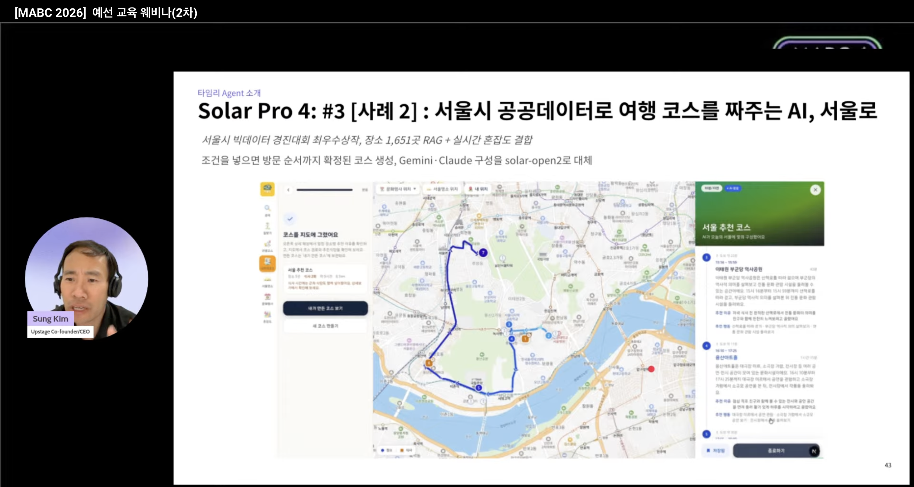

:::user
서울로는 어떤 프로젝트야?
:::

:::assistant
**선택 몇 번으로 시간표까지 완성된 서울 여행 코스를 만들어 주는 지도 서비스**입니다. 서울시 빅데이터 경진대회 최우수상을 받았고, 지금 [seoulro.site](https://seoulro.site/)에서 운영 중입니다.

서비스는 두 부분으로 되어 있습니다.

- **웹 (Next.js)** — 지도, 실시간 혼잡도, 서울명소, 테마 코스, 문화행사, 한/영 다국어까지 사용자가 보는 모든 화면과, 외부 API·AI 서버를 감싸는 BFF(서버 라우트)입니다.
- **AI 서버 (Python)** — 핵심 기능인 "나만의 코스"를 만드는 LangGraph RAG 에이전트입니다. 처음엔 웹 안에 있었는데, LangGraph와 RAG 생태계를 쓰려고 별도 서버로 분리했습니다.

둘 다 직접 설계하고 개발해서 배포했습니다. 화면부터 에이전트까지 한 사람이 끝까지 만든 구조라, 기능 하나를 바꿀 때 프론트·BFF·AI 서버 중 어디를 고쳐야 하는지 직접 판단할 수 있었습니다.

| 항목 | 내용 |
|---|---|
| 기간 | 2026.04 ~ 2026.09 (웹 4월~, AI 서버 6월~) |
| 팀 | 2인 팀 · 웹 커밋 98개 중 69개(추가 코드의 약 91%), AI 서버 커밋 68개 전부 본인 |
| 내 역할 | 프론트엔드 구현, 코스·AI 기능, 지도 UI, BFF, AI 서버, 배포 (대중교통 길찾기 제외 전 과정 개발) |
| 웹 | Next.js 16 (App Router), React 19, TypeScript, Tailwind CSS, Naver Maps, Vercel |
| AI 서버 | Python, FastAPI, LangGraph, Chroma, Upstage `embedding-2`, Gemini, SSE, Docker, Cloud Run |
| 자료 | [웹 레포](https://github.com/seoulbidata/strangemap) · [AI 서버 레포](https://github.com/seoddhh/lewisai) · [서비스](https://seoulro.site/) · [시연 영상](https://youtu.be/ltkDEYeeAxc) |
| 근거 | 커밋 기록([웹](https://github.com/seoulbidata/strangemap/commits/main) · [AI 서버](https://github.com/seoddhh/lewisai/commits/main)) · [모델 비교 평가](https://github.com/seoddhh/lewisai/blob/main/docs/LLM-eval.md) · pytest 91개 |
:::

:::user
어떤 기능이 있어?
:::

:::assistant
**지도 서비스 (웹)**

| 기능 | 내용 |
|---|---|
| 실시간 혼잡도 지도 | 서울시 실시간 인구 데이터로 주요 지점의 혼잡도를 지도 위에 표시 |
| 서울명소 · 테마 코스 | 명소 55곳과 직접 큐레이션한 테마 코스 19개(드라마 촬영지, 한강 야경 등)를 지도 동선으로 제공 |
| 문화행사 | 진행 중인 서울시 문화행사를 카테고리별로 보여줌 |
| AI 장소 안내 | 장소를 누르면 운영시간·혼잡 예보·날씨를 넣어 AI가 방문 팁을 정리 |
| 한/영 다국어 | 화면 문구, AI 프롬프트, 코스 콘텐츠까지 한국어·영어 전환 |
| 모바일 | 바텀시트 기반의 모바일 전용 화면 |

**나만의 코스 (AI 에이전트)**

**선택대로 완성되는 코스** — 동반·목적·위치·시간·식사 수·인원·일수를 고르면 장소 선정부터 방문 시각까지 서버가 확정합니다. `"저녁에 연인이랑 홍대에서 야경"` 같은 자연어 한 줄로도 같은 결과가 나옵니다.

**"왜 이 장소인가"를 함께 추천** — 각 장소에 선정 이유(`reason`)와 그곳에서 할 일(`activities`)이 붙습니다. 실제 시설·볼거리(`highlights`)를 근거로 삼아 "공원이라 산책하기 좋아요" 같은 뻔한 답을 막았습니다.

**실행 가능한 시간표** — 방문 순서는 순열 전수 탐색으로 정하고, 남은 시간을 체류시간 비율대로 나눠 방문 시각과 이동수단까지 확정합니다. 시간 계산은 LLM에게 맡기지 않습니다.

**방문 시각의 예상 혼잡도** — 지금 혼잡도가 아니라 *방문할 시간대의* 서울시 예보를 붙이고, 진행 중인 문화행사와 주변 식당도 함께 보여줍니다.

**생성 과정이 보이는 스트리밍** — SSE로 단계별 진행 상황을 보내서, 코스가 만들어지는 동안 지금 무엇을 하고 있는지 화면에 표시됩니다.
:::

:::user
대외적으로 인정받은 성과가 있어?
:::

:::assistant
**서울시 빅데이터 경진대회 최우수상** — 서울로 서비스로 받았습니다. AI 서버는 이 수상작의 핵심 기능을 에이전트로 다시 만든 것입니다.

**Upstage Solar Agent Partner 선정** — 2026년 7월 Stage 1 파트너로 선정되어, 2주 동안 `solar-open2`로 에이전트를 고도화하고 결과물과 모델 사용 피드백을 제출했습니다.

**업스테이지 공식 행사의 Solar 활용 사례로 소개** — MABC 2026 예선 교육 웨비나(2차)에서 업스테이지 대표가 발표한 "타임리 Agent 소개" 세션에, 서울로가 *"서울시 공공데이터로 여행 코스를 짜주는 AI"* 사례로 실렸습니다.

:::

:::user
실제 사용 지표는 어때?
:::

:::assistant
적극적인 홍보 없이 **검색 유입만으로 쌓은 수치**입니다.

| 지표 | 값 |
|---|---|
| 구글 검색 노출 | 3,500회 |
| 구글 검색 클릭 | 130회 |

*2026-09-29 기준*

홍보를 하지 않은 이유는 **비용**입니다. 코스 하나를 만들 때마다 LLM과 임베딩 API 호출, Cloud Run 실행 비용이 생기는데, 아직 이를 감당할 비즈니스 모델이 없습니다. 그래서 광고 대신 **SEO만 구축**했습니다. 지도 앱은 클라이언트에서만 그려져 검색엔진이 읽을 수 있는 페이지가 홈 하나뿐이었는데, 명소 55곳과 테마 코스 19개를 서버 렌더 페이지로 따로 만들어 **색인 URL을 1개에서 77개로** 늘렸습니다. 코스 생성 이벤트는 GA4로 계측하고 있습니다.

**로그인은 일부러 넣지 않았습니다.** 지금 단계에서는 사용자를 모으는 게 먼저라서, 가입 절차 없이 들어오자마자 코스를 만들어 볼 수 있게 했습니다. 대신 비용을 지키려고 **코스 생성을 브라우저당 하루 3회로 제한**했습니다. 브라우저 저장소 기반이라 우회할 수 있어서, 사용자가 늘면 서버 측 제한이 필요합니다.

근거: [`60a2ec0`](https://github.com/seoulbidata/strangemap/commit/60a2ec0) (SEO) · [`694bf22`](https://github.com/seoulbidata/strangemap/commit/694bf22) (GA4) · [`4df032d`](https://github.com/seoulbidata/strangemap/commit/4df032d) (호출 제한)
:::
